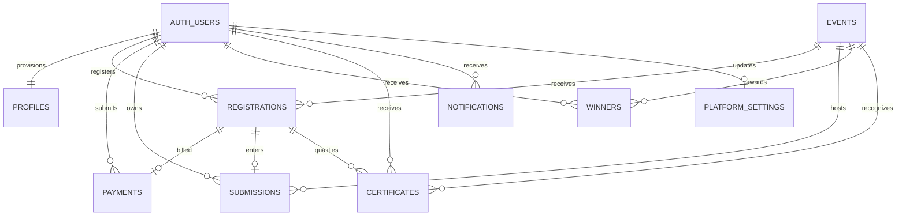

# Ultimate Events Database Relationships

**Status:** Proposed ER view; source baseline only. Live schema has not been queried.

## Existing repository baseline

In the current migrations, registrations are unique per `(event_id,user_id)`, payments have one pending row per registration and unique UTR guard, and submissions are unique per registration. Certificates may be reissued after revocation while only one active certificate per registration is allowed. `platform_settings` is a boolean-keyed singleton. Relationships reflect migrations, not verified remote catalog state.

## Proposed target relationships

```mermaid
erDiagram
  AUTH_USERS ||--|| PROFILES : provisions
  AUTH_USERS ||--o| PARTICIPANT_PREFERENCES : configures
  AUTH_USERS ||--o| USER_NOTIFICATION_PREFERENCES : configures

  EVENTS ||--o| WORKSHOP_DETAILS : specializes
  EVENTS ||--o| COMPETITIONS : specializes
  EVENTS ||--o{ EVENT_SKILLS : tagged_with
  SKILLS ||--o{ EVENT_SKILLS : describes
  EVENTS ||--o{ EVENT_SPEAKER_LINKS : features
  EVENT_SPEAKERS ||--o{ EVENT_SPEAKER_LINKS : appears_at
  EVENTS ||--o{ WORKSHOP_SESSIONS : schedules
  EVENTS ||--o{ EVENT_RESOURCES : provides
  EVENTS ||--o{ EVENT_FAVORITES : saved_by
  AUTH_USERS ||--o{ EVENT_FAVORITES : saves
  EVENTS ||--o{ EVENT_ATTENDANCE : records
  AUTH_USERS ||--o{ EVENT_ATTENDANCE : attends
  EVENTS ||--o{ EVENT_FEEDBACK : receives
  AUTH_USERS ||--o{ EVENT_FEEDBACK : submits

  EVENTS ||--o{ REGISTRATIONS : receives
  AUTH_USERS ||--o{ REGISTRATIONS : registers
  REGISTRATIONS ||--o{ PAYMENTS : billed
  REGISTRATIONS ||--o{ PAYMENT_GATEWAY_TRANSACTIONS : charges
  PAYMENT_GATEWAY_TRANSACTIONS ||--o{ PAYMENT_WEBHOOK_EVENTS : confirms

  COMPETITIONS ||--o{ COMPETITION_PROBLEMS : defines
  COMPETITIONS ||--o{ COMPETITION_TEAMS : allows
  COMPETITION_TEAMS ||--o{ COMPETITION_TEAM_MEMBERS : includes
  AUTH_USERS ||--o{ COMPETITION_TEAM_MEMBERS : joins
  REGISTRATIONS ||--o| SUBMISSIONS : enters
  COMPETITION_TEAMS ||--o{ SUBMISSIONS : submits
  SUBMISSIONS ||--o{ SUBMISSION_FILES : contains
  SUBMISSIONS ||--o{ SUBMISSION_REVIEWS : reviewed_by
  AUTH_USERS ||--o{ SUBMISSION_REVIEWS : reviews

  EVENTS ||--o{ WINNERS : awards
  EVENTS ||--o{ CERTIFICATE_ISSUE_BATCHES : issues
  CERTIFICATE_TEMPLATES ||--o{ CERTIFICATES : renders
  REGISTRATIONS ||--o{ CERTIFICATES : qualifies
  AUTH_USERS ||--o{ CERTIFICATES : receives
  EVENTS ||--o{ CERTIFICATES : recognizes
  ACHIEVEMENTS ||--o{ PARTICIPANT_ACHIEVEMENTS : awards
  AUTH_USERS ||--o{ PARTICIPANT_ACHIEVEMENTS : earns

  AUTH_USERS ||--o{ NOTIFICATIONS : receives
  EMAIL_TEMPLATES ||--o{ EMAIL_LOGS : renders
  AUTH_USERS ||--o{ EMAIL_LOGS : recipient
  EMAIL_LOGS ||--o{ EMAIL_DELIVERY_ATTEMPTS : attempts
  AUTH_USERS ||--o{ ADMIN_MEMBERSHIPS : assigned
  ADMIN_ROLES ||--o{ ADMIN_MEMBERSHIPS : grants
  ADMIN_ROLES ||--o{ ADMIN_ROLE_PERMISSIONS : contains
  ADMIN_PERMISSIONS ||--o{ ADMIN_ROLE_PERMISSIONS : authorizes
  AUTH_USERS ||--o{ ADMIN_AUDIT_LOGS : acts
```

The ER diagram is logical. Optional entities (feedback, waitlists, achievement verification logs, help tickets) should only be implemented after product and operational approval. `SUBMISSIONS` requires an explicit migration decision for team entries and attempt history: the current schema has a unique registration foreign key and must not be silently replaced.

## Cardinality and invariant notes

- **Auth/profile:** one profile per Auth user; IDs remain stable. Existing admin role assignments must be preserved through any permission migration.
- **Event/registration:** one registration per user and event. Do not delete registrations to free capacity; use controlled cancellation and preserve payment records.
- **Registration/payment:** multiple historical payments may exist, but no more than one pending payment for a registration; each UTR is globally unique (case-insensitive). Gateway confirmation is a separate trusted server event.
- **Registration/submission:** current relationship is zero or one submission per registration. File objects are children of a submission; a record's owner is derived through its registration/user and must be checked before signed downloads.
- **Event/workshop/competition:** subtype rows have the same event primary key and FK; event title/status/time remain canonical in `events`.
- **Team membership:** membership limits and unique one-team-per-event semantics require transactional validation; simple row RLS alone cannot safely enforce aggregate limits.
- **Certificate:** certificate snapshots preserve recipient/event display data at issuance. Public verification should return minimum fields and explicit active/revoked status without participant ID or contact data.
- **Emails:** each logical send has a stable unique deduplication key; provider attempts append to history. SMTP/provider acceptance is not equivalent to recipient delivery.
- **Admin audit:** append-only actor/action/resource facts; redact before/after payloads and never store tokens or secrets.
